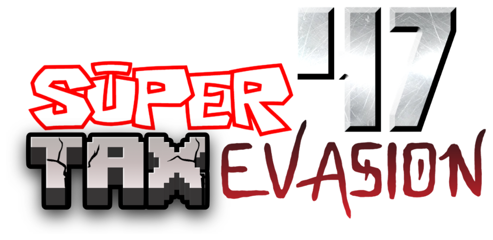

# SUPER TAX EVASION 47

An open-world Metroidvania Soulslike in three.js, with Super Mario 64-style movement.

## Washed-Up Beach

The first area. You wake up face down on the sand in thick sea fog under a heavy grey sky, next to the wreck of the ship you came in on: a broken hull on its side, the snapped mast, crates, barrels and planks along the tideline. Press anything to get up. The sea is to the south (you can wade in up to your waist); the beach rises through dunes to grassland and dark pines in the north, between two rocky headlands.

### Battles (work in progress)

Battles are turn-based. For now there's a temporary test ring of stones on the beach, just inland from where you wake up, with a training dummy in it: walk into the ring and press **B** to start a battle. Each side gets a battle slot (a checkered panel showing Health and Stamina) with a picture of the fighter above it. The commands are **Fight**, **Item** (no items yet) and **Run** (ends the battle).

**Fight:** you run up and strike for 2–3 damage, which costs 3 Stamina; then the enemy takes its turn (the dummy wobbles back at you for 1). You get 1 Stamina back each round, and if you're too tired to attack you catch your breath (+2) instead. Beat the enemy and it keels over; your Stamina refills after the battle. Getting knocked out just ends the battle for now. Pick with the stick / arrow keys and **A**, or click; **B** goes back.

`src/stages/blank.js` is an empty test area (`?stage=blank`).

**Play:** open `index.html` through any static server (or GitHub Pages). No build step; three.js loads from a CDN.

## Controls

| Action | Keyboard / mouse | Gamepad |
| --- | --- | --- |
| A | Space | A |
| B | J, X, left click | X or B |
| Z | Shift, K, right click | Triggers or bumpers |
| Camera | Mouse (click to lock), Q/E rotate, R/F tilt, wheel zoom | Right stick |
| Controls list | H | |
| Mute music | M | |
| Debug readout | F3 or ` | |

Touch screens get an on-screen stick plus A / B / Z buttons.

## Code layout

- `src/main.js`: renderer, Lakitu-style camera, stage switching, game loop
- `src/player.js`: character rig setup and the movement state machine (collision, procedural animation)
- `src/world.js`: sky, lighting and level-building helpers; boxes double as collision
- `src/collider.js`: triangle collision for level models: floors, walls and ceilings
- `src/terrain.js`: heightmap terrain (sand, grass, rock and path blending, colour grading)
- `src/textures.js`: procedural textures (sand, grass, rock, dirt, planks, water) painted at load time
- `src/audio.js`: music and voice lines
- `src/battle.js`: turn-based battles: battle slots, fighter pictures, the Fight / Item / Run menu, battle camera
- `src/stages/beach.js`: the washed-up beach (terrain, sea, wreck, palms, overcast sky)
- `src/input.js`: keyboard, mouse, gamepad and touch
- `src/fx.js`: dust, sparkles, impact shockwave, camera shake

The character's skeleton is posed in code every frame; there are no baked animations. Its head gets the wood texture, the eye decal and the cone hat at load time.

When you change any file, bump `VERSION` and the `?v=` numbers in `src/main.js` and `index.html` so players' browsers don't mix old and new files.

## Credits

Character model: "Fully Rigged Low Poly Character for blender" by [satyasrichaitanya360](https://sketchfab.com/satyasrichaitanya360) on [Sketchfab](https://sketchfab.com/3d-models/fully-rigged-low-poly-character-for-blender-dd918a1760be4849ac1026daa2c58b75), licensed [CC BY 4.0](http://creativecommons.org/licenses/by/4.0/).

Traffic cone hat: "Traffic Cone" by [hinndia](https://sketchfab.com/hinndia) on [Sketchfab](https://sketchfab.com/3d-models/traffic-cone-573feef839d7450cb3e12da9986e7a98), licensed [CC BY 4.0](http://creativecommons.org/licenses/by/4.0/).

Voice lines: supplied by the project owner; from Nintendo's Super Mario 64.
